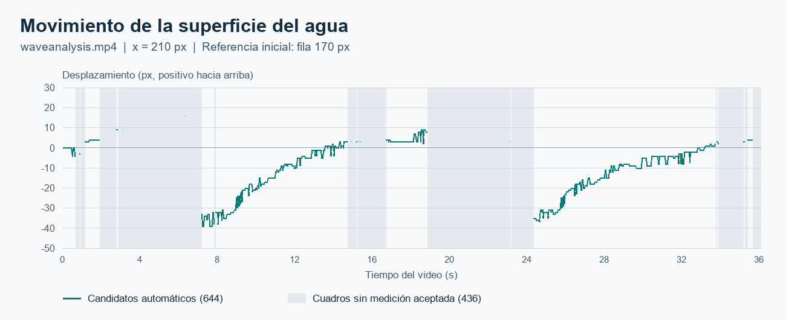

# Seguimiento de la superficie del agua en video

Proyecto de portafolio en Python que convierte el movimiento visible de la superficie del agua en una serie temporal. Genera un video sintético con parámetros conocidos y aplica detección de bordes a un video experimental de rotura de ola.

| Prueba | Resultado |
| --- | --- |
| Video sintético | 600 de 600 cuadros con detección. Error medio de 0.60 px y máximo de 1 px frente a la superficie definida por el generador. La señal recuperó una altura de cresta a valle de 10 cm y un periodo de 2.00 s. |
| Video experimental | 1,080 cuadros a 29.97 fps. El detector seleccionó 644 candidatos y dejó 436 cuadros ambiguos sin medición. Se revisó visualmente una muestra. |

## Método

1. Convertir cada recorte a escala de grises, suavizarlo con un filtro gaussiano y aplicar Canny.
2. Seguir la posición vertical en una columna fija. En el video experimental se mide en `x = 210 px` y se puntúa cuánto del borde candidato está respaldado por los píxeles vecinos.
3. Dejar sin medición los cuadros con bordes competidores, saturación o alta densidad de bordes. Exportar un CSV por cuadro y una gráfica con los huecos visibles.

En el video experimental, el desplazamiento se mide respecto a la mediana de los candidatos del primer segundo (fila 170 px). Los valores positivos indican movimiento hacia arriba. El CSV conserva las marcas de tiempo del video y los puntajes de soporte para auditar la detección. La escala física y la exactitud de los candidatos del video experimental quedan pendientes de validar.



## Reproducir

Instalar las dependencias en un entorno con Python 3.10 o posterior.

```sh
python -m pip install -r requirements.txt
```

### Video sintético

```sh
python generar_oleaje.py
python detectar_superficie.py
python detectar_superficie.py --serie
python validar_sintetico.py
```

Estos comandos generan el AVI, una imagen de verificación, el CSV y la gráfica de la serie. El último comando calcula el error frente al generador, la altura, el periodo y la frecuencia. Los resultados de ejemplo están en `results/`.

### Video experimental

El extractor de MP4 usa Media Foundation de Windows. Coloca una copia de trabajo del clip de referencia en `inputs/waveanalysis.mp4`. El destino de extracción debe ser una carpeta nueva.

```powershell
python extraer_cuadros_windows.py inputs/waveanalysis.mp4 .work/recortes
python exportar_seguimiento.py .work/recortes .work/resultados
```

El encuadre, la columna de medición y los umbrales se ajustaron para este clip. Para otro video habría que revisar esos parámetros antes de interpretar la serie.

## Fuente del video experimental

[Wave breaking: Side](https://www.youtube.com/watch?v=BQptkdzvmjE), publicado por Tom Shand el 30 de julio de 2008. Water Research Laboratory, UNSW. Toma 060708. Investigadores acreditados por la fuente: Tom Shand y Bill Perison. Este repositorio incluye las series y gráficas derivadas. El clip se consulta en la fuente.
